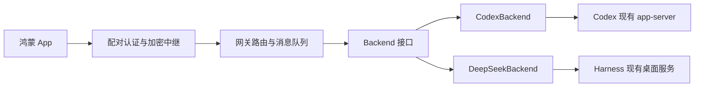

# Codex 与 DeepSeek Harness 双智能体适配设计

日期：2026-11-03

状态：已实现共用网关路由、双适配器及手机切换；DeepSeek 图片发送已核对真实回执和完成回复，停止、审批与问题回复未执行真实操作验收。

## 1. 目标与范围

在现有鸿蒙 App 和 Mac 网关基础上，分别适配 Codex、DeepSeek Harness。手机能够访问电脑已有会话、继续发送消息、查看执行过程与回答、停止任务、处理审批和用户问题。电脑与手机操作的是同一个智能体运行时中的同一个会话。

共用手机页面、网关业务接口、配对认证、加密中继和消息队列。模型、思考深度、Fast 等设置按智能体及具体模型的真实能力展示。

本文只记录设计，不授权修改运行配置、启动智能体任务、发布或提交代码。采用同一台 Mac 一次配对、一个网关同时连接两个后端，手机按请求选择智能体。

## 2. 已核查事实

### 2.1 当前项目

- `gateway/domain.ts` 已定义 `Backend` 接口，`server.ts`、`queue.ts` 通过该接口调用后端。
- `gateway/cli.ts` 固定创建 `CodexBackend`，项目查询也直接调用 Codex RPC。
- `CodexBackend` 通过 Unix Socket 上的 WebSocket JSON-RPC 连接现有 app-server。主会话联动不是每次新启动 CLI 任务。
- `DesktopProjectSync`、`Progress.receive()`、历史解析等实现包含 Codex 专属约定。
- 很多接口返回 `any/unknown`；手机实际依赖 `UiTypes.ets` 中的历史、进度、模型、审批等数据结构。
- 手机聊天页每两秒请求刷新视图。网关内部接收后端事件，不代表目前已将每个回答增量直接推送到手机。
- 手机目前只保存一个 `knownMac`，待发送记录 `pendingSend` 也是单份存储。

### 2.2 本机 DeepSeek Harness

已检查版本为 `0.2.1-rc.2`，安装位置为 `/Applications/DeepSeek Harness.app`。它自带 `dsh` CLI，提供 headless、SDK、ACP、Web 等 profile。

SDK 和 ACP 的 `session/resume` 会在各自运行时恢复 Agent，最终调用 `persistence.open(id, "write")`。本机持久化实现使用 `session.lock` 上的独占 `flock`；会话被其他运行时持有时会拒绝恢复。事件订阅也属于各自运行时。

因此，启动独立 SDK/ACP 进程并传入桌面会话 ID，不能实现对桌面活跃会话的直接附着。历史恢复与两端同时操作是不同能力。

桌面会话控制器会优先复用 `liveAgent(sessionId)`；`session/follow` 提供历史快照与后续事件，`session/control` 提供状态更新。桌面还提供 HTTP 调用、`/api/remote.mux` WebSocket 和认证接入机制，具备实现双端联动的代码基础。

上述为本机静态实现和进程检查结果。未执行登录接入、会话恢复、消息发送、审批或断线联调，不能视为端到端验证通过。

## 3. 架构

两个适配器同时挂载在同一个网关中，共用身份、设备授权及中继连接。

保留 `Backend` 作为适配边界，不增加抽象基类、适配器注册框架或通用插件加载系统。连接、原生协议、事件解释及权限映射由各适配器负责，网关负责设备授权、请求幂等与消息状态持久化。

### 最小设计决策

- 默认网关同时提供 Codex、DeepSeek。加密请求增加可选 `backend` 字段；缺失时使用原默认后端，兼容旧手机。
- 首期只新增 `DeepSeekBackend`，连接逻辑先放在该模块内部；复杂度实际需要时再拆文件。
- 手机继续使用现有视图和两秒刷新机制；不新增事件总线或第二套聊天页面。
- 不改密码协议中的既有名称、网关身份生成规则和配对流程，避免为名称统一引入兼容问题。
- 用 Node 内置 `AsyncLocalStorage` 保存每个请求的后端上下文；不增加插件框架、代理转发框架或动态表单。

## 4. 接口与数据约定

| 能力 | 现有接口 | 适配要求 |
|---|---|---|
| 连接生命周期 | `ready / probe / close` | 各自连接、认证、重连和释放资源 |
| 状态与授权 | `inspect / authorize` | 校验项目归属、真实目录及控制权限 |
| 消息投递 | `deliver / locate / activate` | 发送、核对回执、恢复结果；`activate` 保持可选 |
| 项目与会话 | `navigation / listThreads / projectCatalog` | 将原生 Workspace/Session 转成现有导航结构 |
| 历史与执行 | `history / mobileHistory / historyItem / progress` | 输出手机认可的历史及执行视图 |
| 交互 | `interrupt / listApprovals / replyApproval / answerQuestion` | 适配取消、审批、问题及其生命周期 |
| 模型设置 | `listModels / getModel / setModel` | 使用每个模型的原生设置值与选项 |
| 扩展 | 图片、技能、差异、项目管理等 | 根据实际能力逐项开放 |

优先为主链路补齐明确返回类型，沿用手机现有视图结构，不进行全项目类型重构。`threadId` 可以继续作为统一会话标识名，DeepSeek 内部映射为 `sessionId`。轮次、消息 ID 和历史分页游标必须稳定，不能用每次读取时生成的随机 ID。

DeepSeek 直接把原生事件转换成统一历史、进度、审批视图，不伪造 Codex RPC 事件再调用 `Progress.receive()`。

增加后端标识和功能能力声明。能力可以随版本、模型、会话权限变化；前端据此展示，后端仍对每次操作校验。缺失可选能力时，隐藏相关入口并明确拒绝对应调用，不能返回伪造成功。

只声明会影响现有控件的能力，例如运行中引导、模型修改、权限修改、图片、扩展引用、差异和建议。首期随已有状态响应返回，不增加独立能力服务；会话相关限制随会话视图返回。项目的 `read/control` 授权继续独立处理，功能可用不等于设备获准操作。

前端调用也必须按能力判断：当前选择会话后会自动读取模型和权限，建议功能也会自动发请求。不能只隐藏按钮而保留这些请求。服务端对不支持的能力统一返回 `UNSUPPORTED_COMMAND`。

## 5. 模型、Fast 与思考深度

统一模型设置入口，选项由适配器从后端模型目录取得。

| 设置 | Codex | DeepSeek Harness |
|---|---|---|
| 模型列表 | Codex 返回的可用模型 | Harness 返回的可用模型 |
| Fast | 仅支持的模型显示 | 不显示，也不发送该参数 |
| 思考深度 | 使用该模型原生档位 | 使用该模型原生档位，不映射为 Codex 档位 |
| 不可调设置 | 隐藏对应控件 | 隐藏对应控件 |

将现有 `efforts: string[]` 的表达扩展为实际值与显示名称，例如 `{ value, label }`，并声明是否可调、默认值及当前值。`value` 是后端认可的原生值，`label` 只负责展示。允许默认值或未指定值保持未指定，不能自动填入其他模型的档位。

Fast 作为独立可选能力，不和思考深度合并。模型切换后重新读取支持项及最终生效设置，清理上一模型遗留的 Fast、深度值；不支持的字段应省略，不能用空字符串替代原生语义。未知当前值应展示为未知或自定义，不能静默降档。

DeepSeek 的确切深度选项尚未读取本机实时模型目录，实施前需只读核实。固定写死 low/medium/high 不属于本方案。

最小数据调整：保留模型列表现有结构，为深度增加可选的 `effortOptions: [{ value, label }]`，为当前设置保留原生值；过渡期间 Codex 继续返回已有 `efforts`，新手机优先读取新选项。Fast 继续使用现有可选 `fastTier`，DeepSeek 不提供该字段。不引入任意字段描述器或动态表单引擎。

设置请求只提交用户修改的字段。省略表示不修改；恢复默认必须由适配器明确支持，不能混用空字符串、`null` 和省略。若后端不支持原子修改模型及深度，按后端要求执行并回读最终状态；中途失败时显示实际状态，不报告全部成功。两端同时修改时以桌面服务最终状态为准，暂不增加配置版本锁。

## 6. 消息可靠性与权限

### 消息

- 网关消息 ID 与 Harness 请求标识建立稳定对应关系；重试不得产生新请求标识。
- 原生接收确认、进入队列、开始执行是不同状态，按真实回执映射 `Delivery`。
- `locate` 应结合原生队列或持久事件核对消息；是否能完整查询到所需标识需进一步验证。
- 超时后保持未知状态并核对，不盲目重发。无法证明未接收时不得自动重放。
- 首期沿用现有网关忙时排队。运行中引导只有在能保证目标轮次语义时开放。

沿用现有状态机，投递状态和任务运行结果分开：

| 状态 | 统一含义 | 恢复规则 |
|---|---|---|
| `queued` | 消息只在网关等待 | 发送前重新检查设备权限与会话状态 |
| `dispatching` | 已开始向后端提交 | 进程重启后转为 `unknown` |
| `nativeQueued` | 后端已确认接收，尚未确认关联轮次 | 查原生队列或事件，不再次发送 |
| `attached / steered` | 已确认关联普通或引导投递 | 不表示任务执行成功 |
| `unknown` | 无法确认后端是否接收 | 保留原消息，查询回执，不自动重发 |
| `failed / cancelled` | 明确拒绝或取消网关待发消息 | 不能用它表示未知的原生执行结果 |

Harness 的 `accepted: true` 不直接等于 `attached`；确认轮次前可映射为 `nativeQueued`，由 `locate` 更新。它没有需要额外调用的消费步骤时，不实现 `activate`。查询无结果、暂时不可查询和明确未接收必须在适配器内区分；不能把暂时无记录当成可以重发。

网关检查空闲后，桌面仍可能抢先发起新任务。适配器必须核实原生发送模式在此竞争下的语义；不能保证“等待下一轮”时，不开放对应控制能力。停止和引导同样不能误作用于检查之后新开始的轮次。

### 权限和交互

- 手机设备授权与 Harness 自身执行权限分别校验。
- 不直接把 Codex 的 `ask/full` 名称套到 Harness；按实际权限预设和审批行为映射，无法等价时展示真实模式并限制操作。
- Harness 认证材料仅留在 Mac，手机继续使用现有网关认证，不直接取得桌面访问凭据。
- 桌面已经处理的审批和问题应同步从手机待处理列表移除；拒绝迟到、重复或已取消的回答。
- 断线重连后重新取得有效快照和待处理交互，不使用旧连接中的请求句柄回复。

`close()` 只关闭网关持有的连接和订阅，不退出桌面应用、不关闭桌面 Agent。读取会话时不得顺带修改模型或权限。对原生服务必须激活会话才能读取的情况，需先核实副作用，不把恢复操作假定为纯查询。

## 7. 最小落地范围

| 位置 | 改动 |
|---|---|
| 新增 `gateway/deepseek.ts` | Harness 连接、事件订阅、视图转换、消息回执、权限与交互适配 |
| `gateway/domain.ts` | 后端标识、能力声明、主链路返回类型和模型选项结构 |
| `gateway/codex.ts` | 适配新契约，保留原有协议行为 |
| `gateway/cli.ts` | 配置选择后端；项目查询使用适配器；仅 Codex 启动桌面项目同步 |
| `gateway/config.example.json` | 后端类型、连接配置示例，不包含真实凭据 |
| `gateway/server.ts` | 返回能力信息并执行能力校验，保持手机主接口 |
| `gateway/secure-ws.ts` | 将固定 Codex 故障文案改为适用于当前后端的提示 |
| 手机 `UiTypes / UiState / MobileSession` 与设置控件 | 接收能力与模型选项，控制功能展示和请求参数 |

具体文件拆分以实施时的复杂度为准，不提前创建空模块。配对、加密、中继和队列原则上复用；若消息状态无法准确表达 Harness 行为，应补足状态约定，而不是错误复用已有状态。

首批必须覆盖已有会话的查看、发送、回答与工具状态、停止、审批、问题及重连。图片、技能、差异、项目管理、自动建议等按验证结果逐项接入，不承诺首批功能完全对齐。

## 8. 共用网关、授权与数据隔离

同一个进程提供两个后端，只读取一份网关密钥和一份设备授权。手机扫码一次后，连接期间的每个加密请求携带 `backend: codex | deepseek`，由服务端选择请求上下文。未知后端明确拒绝，不回退到另一个智能体；手机请求队列在入队时固定后端与连接绑定，不随之后的界面选择变化。Unix 本地管理接口可用 `x-agent-backend` 选择只读查询目标，旧请求仍走默认后端。

保留原 `ledger.sqlite`、`noise-identity.json`、设备 ID、签名公钥、授权和原后端绑定。另一个后端在同目录使用 `<kind>-ledger.sqlite`，分别存放消息、回执、权限确认、建议和会话 UI 状态；队列和图片上传暂存同样分开。无需改写旧消息 ID 或迁移旧表，也不复制、删除已有独立网关目录的数据。设备撤销会作用于所有后端，关闭网关会释放所有后端连接。

项目授权仍基于原有授权目录，不混入展示层级。统一导航继续使用现有 `sections[].projects[]` 和 `sections[].threads[]`：分区可以同时包含项目和直接会话，项目包含自己的会话。Codex 保留原生分区、项目与直接会话；Harness 的每个工作区映射为一个分区，`projects` 留空，会话直接进入该分区的 `threads`。不同工作区始终保持独立，不因共享同一个授权目录而合并。

Harness 会话的 `projectId` 继续引用已有目录授权，作为内部安全作用域，不代表手机需要展示“项目”这一层。可选 `scopeProjects` 只向手机提供可执行/只读权限上下文；分区名称和会话归属来自 Harness。网关同步发现 Codex 和 Harness 的全部项目、工作区，所有已配对的有效设备默认获得执行权限；新发现的目录自动加入，不再使用逐项授权。设备身份验证及整台设备撤销仍然有效。

手机将 `knownMac` 作为共用连接；缺失时优先复用此前 Codex 配对，再使用既有 DeepSeek 配对，旧记录保留。草稿、附件引用、待发送记录和会话位置仍按智能体与网关身份隔离。切换时关闭旧请求通道，保留旧智能体未确认的投递记录，再用同一设备身份恢复新后端；不重新配对、不自动重发消息。

## 9. 实时体验与后续验证

首期沿用当前体验：适配器订阅桌面事件并维护状态，手机每两秒拉取统一视图。该方案属于持续刷新同步，不承诺逐 token 即时推送。需要更低延迟时，再增加加密通道事件推送及断线补偿。

适配器断线后将 `ready` 置为 false，停止新消息派发，清除失效的审批句柄；重连后重新认证、订阅并读取快照，再恢复控制。历史与实时消息使用稳定标识合并，轮次结束后以持久历史为准。原生游标和网关消息队列游标分别使用，不相互替代。切换会话和关闭网关时释放不用的订阅，避免不断积累连接资源。

### 实施顺序与完成标准

1. **整理契约**：为 Codex 补能力和模型选项，手机处理缺失能力；现有 Codex 功能仍可使用。
2. **接通只读链路**：DeepSeek 的认证发现、导航、历史与进度转换；结果与桌面同一会话一致。认证材料来源未确认前不提供臆造的配置方式。
3. **接通控制链路**：完成发送及回执、停止、审批和问题处理；确认超时恢复不重复发送、桌面处理后手机状态同步。
4. **验收后再扩展**：达到上述主链路即停止扩大范围；手机双连接切换和额外功能单独实施。

如果只能查看、不能可靠控制或恢复回执，明确标为只读接入，不能作为完整双端联动验收。各阶段验证方式遵循下文限制。

兼容与回退保持简单：旧 Codex 配置默认选择 Codex，新字段采用兼容新增；未声明新能力的旧网关只按已知旧版 Codex 行为兼容，不能把未知后端当成全功能。DeepSeek 的状态独立，不迁入 Codex 账本。若实施需要升级账本 schema，必须单独明确迁移与回退方式；不能假定旧二进制可以读取新 schema。

实施前待核实：

1. Harness 桌面端口与认证材料的稳定发现方式，以及重启后的变化。
2. 实时模型目录、思考深度、权限预设的真实值及更新行为。
3. 请求标识在队列与持久日志中的可查询性，能否完整实现 `locate`。
4. 双客户端审批竞争、问题回复、取消与重连后的处理规则。
5. Workspace、Session、轮次与历史游标的准确映射及订阅资源释放。

后续验收应覆盖：两端发送进入同一会话、回答不重复、停止命中当前运行、审批处理后两端一致、断网恢复不重发、模型切换不残留不支持参数、后端切换不串消息。

验证优先使用静态检查、构建、已有测试和用户授权范围内的操作核对。不新增测试用例、临时验收脚本、模拟数据或测试会话；涉及真实发送和审批的验证另行明确执行范围。本次未进行这些操作。

## 10. 核查依据

- 本项目：`gateway/domain.ts`、`cli.ts`、`codex.ts`、`queue.ts`、`server.ts`、`progress.ts`、`desktop-sync.ts`。
- 手机：`harmony/entry/src/main/ets/model/UiTypes.ets`、`MobileSession.ets`、`components/WorkspaceView.ets`。
- 本机 Harness `app.asar` 内：`dsh-sdk-jsonrpc-server`、`dsh-acp`、`dsh-agent-loop`、`dsh-session-persistence-jsonl`、`dsh-api-session-controller`、`dsh-api-gateway`、`dsh-client-connection` 的实现和随附文档。
- 官方参考：[SDK 服务](https://github.com/deepseek-ai/deepseek-harness/blob/master/packages/sdk/server/README.zh.md)、[ACP](https://github.com/deepseek-ai/deepseek-harness/blob/master/packages/acp/acp/README.zh.md)。线上文档会变化，本机行为判断以已检查版本为准。

## 11. 第二阶段实现记录

已新增只读 `DeepSeekBackend`，通过本机 `lsof` 查找 Harness 进程的回环监听端口，并以 SQLite 只读模式读取桌面已有的 Harness Cookie。凭据仅保存在 Mac 进程内，不输出日志、不发送给手机。桌面退出、认证失效或协议不兼容时返回不可用，不启动 Harness、不恢复 Agent。

只调用 `session/list`、`session/page` 和 `session/follow`。历史映射为统一会话视图，包含原生事件序号形成的稳定消息 ID、历史分页和长消息分段读取；跟随流用于接收持久事件、工具状态和临时回答文本。订阅数量上限为 8，闲置五分钟释放，关闭适配器只关闭自身连接。遇到事件缺口时放弃旧订阅并在下次读取重取快照。

此阶段 `readOnly=true`，控制授权、发送、停止、模型及权限修改均不可用，手机导航和项目列表仅展示只读权限。网关状态目录绑定后端种类，禁止将 Codex 账本交给 DeepSeek。配对和退出登录继续可用。

启动入口增加 `--backend codex|deepseek`，默认 Codex。只读发现项目可使用 `projects --backend deepseek`。启动 DeepSeek 网关使用已有 `--config` 项目根目录授权和独立 `--state-dir`；本次未修改任何运行配置，也未启动网关或中继。启动配置仍是用户的项目授权清单，不自动授权发现的目录。

本机读取核对已确认：可连接现有桌面服务、发现已有会话、读取历史快照；未发送任何任务。当前核对时没有正在运行的会话，因此真实生成过程的增量显示和手机端接入尚未现场验证，不作为已通过事项。

## 12. 第三阶段实现记录（代码完成，控制接口未实调）

本阶段沿用现有网关消息队列和账本，仅扩充 `DeepSeekBackend`。DeepSeek 现有会话可按设备原有的 `read/control` 授权显示；不新增会话、修改模型或执行权限预设，运行中引导继续关闭。

- **发送**：只接受纯文本，原生 `session/prompt` 使用 `mode: queue`，网关消息 UUID 作为稳定的 `requestId`。原生确认 `accepted` 后记录为 `nativeQueued`，不直接宣称已经开始执行。桌面抢先发起任务时，原生队列模式仍作为后续输入处理。
- **回执**：读取最新 inbox projection，并按 `source.rpcId` 检索持久历史；同时核对正文。确认轮次后转为 `attached`。每次核对至多向前查询 20 页，超出或证据不足保留未知状态；不自动重发，也不声称提供无限历史范围的即时回执恢复。
- **控制授权**：发送、停止和交互回复前重新核对会话目录、当前工作目录与原生权限。仅 `workspace-write`、`read-only` 两种已识别受限模式允许手机控制；未知和完整权限模式拒绝。手机不修改这些设置。
- **停止**：先核对手机期望的活动轮次，再调用原生 `session/cancel`。本机协议没有原子 `expectedTurnId` 参数，因此检查与调用之间仍存在桌面切换轮次的竞争窗口。取消保留原生 pending inbox，不等于清空所有排队任务；不自动重试取消。
- **审批**：独立订阅 `$events`，按原生 `clientId/eventId` 保存当前连接的请求。手机仅支持一次性允许和拒绝；原生撤销通知会移除卡片。非授权项目或不支持的事件向原生链路委托 `next`，不替用户批准。
- **问题**：前台问题通过同一事件结果通道回复；超时后处于 `continued` 的问题通过 `userQuestions/answer` 回复。校验问题 ID、选项、单选/多选和自定义答案；已进入原生队列的后续回答不再显示为可重复提交。
- **不确定结果**：发送的网络异常和原生错误不归类为已证明未投递；交互回复超时后也不自动重发。断线清除旧连接的待处理句柄，重新订阅时只接收原生仍在等待的请求。

补充核查发现：`session/follow` 对冷会话存在快照后调用 `promote` 的路径，可能恢复桌面 Agent。因此第二阶段“所有跟随读取均不会恢复 Agent”的表述不成立；本文件第 11 节记录的是当时实现和读取结果，不能据此承诺冷会话跟随完全无激活副作用。后续运行验收应使用明确选定的会话，并把冷会话恢复行为纳入核对。本阶段未执行任何桌面接口或启动网关，因此本次改动没有触发恢复或任务执行。

本阶段只读取本机安装包中的协议实现并进行 TypeScript 静态检查/构建；未实调发送、停止、审批、问题回复，也未修改运行配置、创建测试材料或提交代码。原生协议兼容性、双端竞争和真实断线恢复仍需在用户明确授权的运行验收中确认。

## 13. 手机展示与目录缓存

顶部固定提供带官方产品 Logo 的 Codex、DeepSeek 切换项。切换后读取目标后端状态、能力、导航和目录，再更新手机项目列表；聊天框、空状态和提示使用实际智能体名称。没有创建会话能力的后端仅显示已有会话入口，不提供虚假的新建任务入口。

Harness 导航来自 `workspace/follow` 的首个基线，以及 `session/list`。复用统一分区的直接会话结构，展示“工作区 → 会话”，不增加项目层。按原生工作区名称、会话手动顺序、置顶与归档状态展示；最近会话通过既有 `recentThreads` 字段提供，避免与仅表示未归类会话的 `recent` 混淆。所有工作区默认可执行，不显示未授权入口。

Harness 技能通过 `skills/list` 读取当前会话的真实 composition；没有选中会话时使用该授权目录最近的已有会话。插件通过 `pluginManager/listBundles` 读取已启用的可选或外部插件，排除基础运行时和未启用条目。此同步仅读取元数据，不安装、启用、禁用或配置插件。

网关按后端实例、授权项目和会话缓存目录 15 秒；手动同步及切换后的同步绕过缓存。手机仅保留当前目录的内存状态，不增加持久目录数据库；智能体、网关、项目或会话切换时清空旧目录并读取新目录。图标缓存包含智能体作用域。用户选择的技能或插件随消息以明确文本意图传给 Harness，发送前重新核对启用目录；不把 Codex 的原生引用协议发送给 Harness，也不自动改变插件状态。

旧版手机偏好和 Codex 草稿按先前约定迁入新作用域，设备签名和传输密钥保持不变。Logo 来自本机官方桌面安装包资源。所有阶段均不新增测试用例或提交代码；现场核对只使用已有设备、真实只读目录和数据完整性检查，不发送智能体任务。

## 14. 默认授权与全文展示

用户明确规定：所有项目和工作区默认授权，这是固定产品规则。网关启动及目录同步时合并两个后端的目录（包括尚无会话的 Harness 工作区），对现有有效设备补齐全部执行授权，并为新设备和后续新目录默认授予 `control`。保留设备 ID、签名公钥和网关密钥，不要求重新配对；只撤销整台设备时才终止访问。旧的逐项限制接口不得使设备回到未授权或只读状态。该规则针对网关目录授权，不通过修改 Harness 配置或绕过智能体原生执行策略实现。

“查看全文”中的助手回复复用聊天页已有 `MarkdownBody`。分段读取的文本先原样拼接再解析，避免代码围栏、表格或列表在分页边界被拆坏；工具日志仍保留原有纯文本展示和复制方式。不增加 Markdown 依赖或新测试。

## 15. 会话展示适配器

`ConversationAdapter` 只约定原生历史转展示页、原生条目转全文两项职责，不引入 UI 工厂或第二套聊天页面。Codex 复用已有历史格式化与执行摘要；DeepSeek 使用独立展示适配器处理原生事件。手机只消费规范角色（用户、助手、工具）、文本、执行摘要及可选的分组键和全文读取标识，保留旧 Codex 网关的类型兼容。

DeepSeek 按 `source.kind` 判断真实用户输入，保留 `user` 和用户问题回复；`agent-instructions`、`runtime-context`、`skill-catalog`、`time-context` 等内部注入不再画成用户气泡，也不通过全文接口展示。此判断不按正文中的标签字符串删除内容，因此用户真实输入含有 `<system-reminder>` 等文字时仍原样保留。原始桌面会话记录不改写。

工具调用和结果按原生 `callId/toolCallId` 合并为一条卡片，正文预览和全文使用同一关联。原生拒绝、取消和失败分别转为展示状态；没有结果时不伪报完成。DeepSeek 每个调用使用自己的分组键，避免把不同调用及结果合并成大量重复执行条目；Codex 继续保留原有相邻同类工具的折叠方式。生成中的消息仍由现有进度通道提供，展示模型与历史保持一致。

## 16. 聊天工具栏的 Agent 能力适配

工具栏保留公共图片、扩展、执行策略、模型和发送/停止入口；能力由各适配器实际实现后声明，不能用一个长期为 false 的占位能力冒充完整适配。显式 `@` 按钮与输入触发的扩展菜单共用组件。

Harness 模型目录来自 `session/modelCatalog`，模型选择同时保留 provider 与 model 身份。当前真实可用目录包括 Flash、Pro，思考选项为 `off/low/high/max`；UI 使用对应中文标签，不加入 Codex 的 medium 档位，也不提供 Fast。读取当前模型只使用 projection；修改走原生 `session/selectModel` 并核对确认结果，不在只读同步中自动修改。原生选择行为可能同时保存 Harness 默认值，只有用户明确点击时执行。

执行策略面板使用适配器返回的原生选项。Harness 从 `permissionPresets/catalog` 读取选项，用原生 `/permission` 命令选择当前会话策略，并回读确认。高权限或自动审查模式要求明确确认；确认记录按后端账本及会话保留，重启和设备撤销按同一作用域处理。此处是智能体执行模式，不是项目/工作区访问授权，所有目录默认授权规则保持不变。Codex 保留原有三个选项及语义。

图片沿用手机和网关既有的上传暂存，转为 Harness 接受的 inline image content。回执按原请求 ID 及图片实际字节核对；历史以附件引用显示图片，读取时校验会话、事件和附件关联，使用分块传输及最多四张的内存缓存。复用手机端每条最多四张、合计 8 MiB 的限制，并额外检查原生会话图片限制；图片读取独立计入媒体请求限流，避免分块挤占会话刷新预算。不创建演示图片或测试任务。

本轮验收仅读取真实模型/策略目录、检查界面并运行构建；没有实际切换模型、执行策略，或向智能体提交图片任务。能力实际操作仍需用户正常使用时验证，不能将构建通过写成端到端操作通过。

## 17. Harness 按工作区新建会话

侧栏“新对话”打开工作区选择页，每个工作区右侧提供 `＋`。由该按钮明确发起新建，调用原生 `session/create` 的 `workspaceId`，不插入 Codex 项目层。导航分区通过可选 `workspaceId`、`scopeProjectId` 传递创建目标及既有目录授权关联。

新建空会话沿用 Harness 自身默认模型和执行策略，不发送提示词，不调用全局默认模型初始化接口，不把 Codex 的 ask/auto/full 参数套入 Harness。空会话尚无模型选择记录时，读取原生模型目录的默认值供界面展示，后续修改仍由用户明确操作。

手机按智能体和网关身份保存未确认的新建请求。网关用请求主体身份、工作区和客户端请求 ID 生成稳定创建键及原生会话 ID，在对应后端账本的 `thread_creations` 中记录新建状态。首个请求允许创建；结果未知后的重试只查询该原生 ID，不重新发起创建，避免 Harness 对已开始的同名会话另行生成新会话。明确的创建前失败才允许重新派发。手机新建过程中等待旧刷新及草稿保存，成功后打开新会话并同步目录。

此阶段只核对安装包中的原生协议和构建/入口展示，不调用实际创建接口，不创建验收会话或发送任务。既有 Codex 延迟到发送时创建会话的流程保留。

## 18. 会话长按菜单

菜单动作由适配器的 `threadActions` 提供标签和语义键。Codex 保留重命名、固定、项目、分区、封存；Harness 暴露原生可用的重命名、置顶/取消置顶、归档。手机侧栏与快捷列表不再通过“是否 Codex”决定能否长按；快捷菜单复用公共重命名/固定/归档动作，侧栏保留 Codex 的项目和分区编辑器。

Harness 管理操作前重新读取会话和工作区元数据并核对目录作用域；分别调用 `session/rename`、`workspace/pinSession`、`workspace/unpinSession`、`workspace/archiveSession`，核对返回结果后刷新目录。归档不请求 `stopActivity`，会话或后台活动仍在运行时拒绝，不隐式停止用户任务。未提供跨工作区迁移接口的能力不伪装成移动到 Codex 项目或分区。

归档前保护该智能体/网关作用域下的未发送草稿、附件和未确认消息。归档当前 Harness 会话后只清理页面选择，不再调用新建流程或自动创建替代会话。Pin 状态由原生目录返回，菜单文字随最新状态变化。

本轮只核对原生接口、读取元数据、构建并打开长按菜单验证；不对真实会话执行重命名、置顶、归档或移动，也不新增测试或提交代码。

## 19. 失败回执与图片上传修复

Harness 可能在取出 inbox 消息后、写入 `user/message` 前因提示词错误结束回合。网关按原始 inbox 变更、回合和 step 事件核对该路径，解除待处理阻塞，同时保留未进入正式历史的消息恢复内容；不重发消息或修改 Harness 提示词配置。

两种智能体共用的手机加密通道逐片等待 WebSocket 发送完成，保持 Noise nonce 和分片顺序。上传期间连接更新即终止旧连接发送，草稿仍保留。

Harness 会规范化图片尺寸与编码，因此回执以原始请求 ID、消息结构、文字及不可变附件哈希核对，不要求规范化后的图片与原图逐字节相同。已按用户明确授权发送手机现有图片草稿，确认上传、桌面图片附件、消息回执及完成回复均正常；未另建测试会话，也未向 Codex 额外发送任务。
